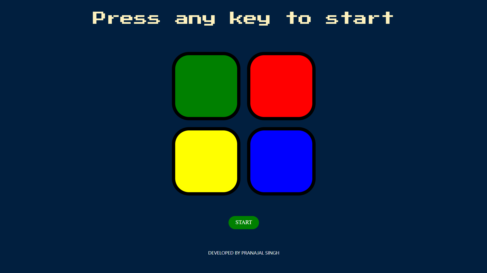

# 🎮 Simon Game

A web-based recreation of the classic Simon memory game. Test your memory by repeating an ever-growing sequence of colors and sounds. Built with HTML, CSS, JavaScript, and jQuery.

[](https://pranajalsingh.github.io/THE_SIMON_GAME/)
[](LICENSE)

---

## 📸 Preview

<p align="center">
  
</p>

---

## ✨ Features

- Classic Simon gameplay: repeat the sequence of colors and sounds
- Responsive design for desktop and mobile
- Animated button feedback and sound effects
- Tracks your current level and notifies on game over
- Simple, retro-inspired UI

---

## 🕹️ How to Play

1. **Start the Game:** Press any key or click the "START" button to begin.
2. **Watch the Sequence:** The game will highlight a sequence of colored tiles, each with a unique sound.
3. **Repeat the Sequence:** Click the tiles in the same order as shown.
4. **Level Up:** Each round, the sequence gets longer. Try to remember as much as you can!
5. **Game Over:** If you make a mistake, the game ends and you can restart.

---

## 🚀 How to Run Locally

Follow these exact terminal commands to clone and run the project on your device:

1. **Clone the repository:**
   Open your terminal (Mac/Linux) or Command Prompt/Git Bash (Windows) and run:

  ```Bash
  git clone https://github.com/PranajalSingh/THE_SIMON_GAME.git
  ```
2. **Navigate into the project directory:**

  ```Bash
  cd THE_SIMON_GAME
  ```

3. **Open the project:**

  - Quickest way: Double-click the index.html file inside the folder to open it directly in your default web browser.

  - Using Command Line (Mac):

  ```Bash
  open index.html
  ```
  
  - Using Command Line (Windows):

  ```Bash
  start index.html
  ```

  - Using Command Line (Linux):

  ```Bash
  xdg-open index.html
  ```

---

## 📂 Folder Structure

```text
THE_SIMON_GAME/
├── index.html         # Main HTML file
├── style.css          # Stylesheet
├── script.js          # Game logic (JavaScript)
├── sounds/            # Sound effects (mp3)
│   ├── blue.mp3
│   ├── green.mp3
│   ├── red.mp3
│   ├── yellow.mp3
│   └── wrong.mp3
└── README.md          # Project documentation
```

## Credits
- **Developed by:** Pranajal Singh
- **Font:** [Press Start 2P](https://fonts.google.com/specimen/Press+Start+2P) by Codeman38
